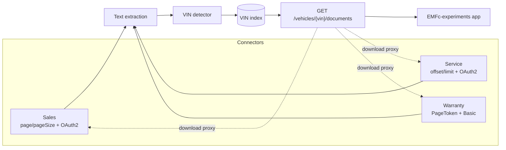

# 02 - System Design

## Problem recap

- Three dealership systems ([Sales, Service, Warranty](../DealershipSystems/README.md))
  hold vehicle documents in mixed formats, including PDF, HTML, CSV, TXT, JSON,
  XML, SVG, EML and MD.
- **None of them can be queried by VIN.** Each groups documents by its own key,
  such as a deal, document kind or claim. The VIN appears only inside document
  content, and some documents have no VIN.
- Each system has its own API path, paging style (page number, offset or opaque
  token), JSON format and authentication method. All three apply rate limits;
  Warranty allows only 30 requests per minute.

## Decision: pre-index, do not federate at query time

A live search would need to download and read every document from all three
systems for each VIN lookup. That would be slow and would quickly exceed the
rate limits. Instead, the solution syncs each system in the background, extracts
VINs from every document, and keeps a **VIN index**. A user's VIN lookup reads
only that index.

This connector → extract → index pattern is also used by
[Onyx](https://github.com/onyx-dot-app/onyx),
[Apache ManifoldCF](https://github.com/apache/manifoldcf) and
[Elastic connectors](https://github.com/elastic/connectors). Those projects were
too large for this use case, so ProjectLoop builds a small version in .NET.



## Components (`src/`)

| Component | Responsibility | Choice |
|---|---|---|
| Connector, one per system | Page through all documents, open a document's content, and hide differences in paging and JSON format | Typed client generated from each system's OpenAPI with Kiota or NSwag |
| Authentication handler | Get and cache OAuth2 client-credentials tokens for Sales and Service; send Basic credentials to Warranty | `DelegatingHandler` per connector, with credentials from configuration or user secrets |
| Resilience | Retry temporary failures and wait for the time in `Retry-After` when rate-limited | Polly through `Microsoft.Extensions.Http.Resilience` |
| Text extraction | Extract plain text for each content type | PdfPig for PDF, AngleSharp for HTML, MimeKit for EML, and plain-text reading for other formats |
| VIN detector | Find VIN candidates in extracted text | Regex `[A-HJ-NPR-Z0-9]{17}`. The check digit is **not** required because many non-North-American VINs do not use one. |
| VIN index | Map each VIN to document references | SQLite first, then Postgres. Use Meilisearch or Elasticsearch only if full-text search is needed. |
| Sync worker | Sync each system on a schedule and incrementally | `BackgroundService` that skips unchanged documents using a content hash or last-modified date, and removes documents that disappeared |
| Query API | Search documents by VIN and stream downloads | ASP.NET Core; the frontend never receives dealership credentials |

### Common connector contract

```csharp
public interface IDocumentSource
{
    string SourceName { get; }
    IAsyncEnumerable<SourceDocument> ListAllAsync(CancellationToken ct);
    Task<Stream> OpenAsync(string sourceDocumentId, CancellationToken ct);
}

public sealed record SourceDocument(
    string SourceName, string SourceDocumentId, string FileName, string ContentType,
    string? BusinessKey,          // deal number, document kind or claim number
    DateTimeOffset? ModifiedAt);
```

### Index record

| Field | Notes |
|---|---|
| `Vin` | Empty when no VIN is found, so unlinked documents remain visible |
| `SourceName`, `SourceDocumentId` | Natural key |
| `FileName`, `ContentType`, `BusinessKey` | Display metadata |
| `ContentHash`, `ModifiedAt`, `LastSeenAt` | Detect changed and removed documents |

A document that contains several VINs gets one row per VIN.

### Query API

- `GET /vehicles/{vin}/documents`: returns unified results from every source,
  sorted by date, with each result's source and business key.
- `GET /documents/{source}/{id}/content`: streams the original file through the
  matching connector.
- `GET /documents/unlinked`: lists documents where no VIN was found, so the team
  can review them.

## Implementation steps

1. Create the `src/` solution with the `IDocumentSource` contract and a test project.
2. Implement the Sales, Service and Warranty connectors, including authentication,
   paging and retries. Test them against the running mock systems.
3. Add text extraction and VIN detection, with unit tests using the sample documents.
4. Add the VIN index and sync worker, including incremental updates and removal
   of missing documents.
5. Add the query API and the download proxy.
6. Build the frontend in EMFc-experiments under `src/` using its existing theme.
7. Test the hypothesis:
   - Compare results with a hand-made list of which documents belong to each VIN.
   - Report coverage as documents found divided by expected documents.
   - Report lookup time for the unified search and for searching each system manually.

## Acceptance criteria

- Searching `1HGCM82633A004352` returns every document that mentions it in
  Sales, Service and Warranty.
- Service's scratch note and other documents without a VIN appear in
  `/documents/unlinked` and are not silently dropped.
- Warranty documents missing from `manifest.json` are not indexed, because the
  Warranty system does not expose them.
- Each sync respects the source rate limits and does not receive repeated `429`
  responses.
- The frontend never receives dealership credentials.

## Out of scope for now

- OCR for scanned PDFs and images. Add a Docling-serve or Apache Tika container
  if those documents appear.
- Matching partial VINs or decoding VIN details.
- Real-time updates from the source systems; scheduled sync is enough.
