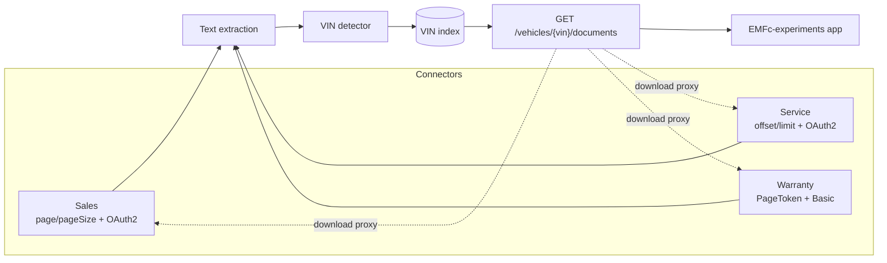

# 02 - System Design

## Problem recap

- Three dealership systems ([Sales, Service, Warranty](../DealershipSystems/README.md))
  hold vehicle documents in mixed formats, including PDF, HTML, CSV, TXT, JSON,
  XML, SVG, EML and MD.
- **None of them can be queried by VIN.** Each groups documents by its own key,
  such as a deal, document kind or claim. The VIN appears only inside document
  content, and some documents have no VIN.
- Each system has its own API path, paging style (page number, offset or opaque
  token), JSON format and authentication method. All three apply rate limits;
  Warranty allows only 30 requests per minute.

The supplied scenario names Sales and Service as the required pair. Warranty is
an additional mock source in this repository; it extends the same connector
contract but does not replace the Sales-and-Service acceptance criteria.

## Decision: pre-index, do not federate at query time

A live search would need to download and read every document from all three
systems for each VIN lookup. That would be slow and would quickly exceed the
rate limits. Instead, the solution syncs each system in the background, extracts
VINs from every document, and keeps a **VIN index**. A user's VIN lookup reads
only that index.

### Parallel source synchronization

The background worker starts an independent sync for every enabled source at
the same time. Each source gets its own dependency-injection scope and
`DbContext`; a failure is logged for that source and does not cancel the other
syncs. This is the backend's parallel aggregation point. VIN searches query the
consolidated local index rather than making live dealership requests, so a slow
or rate-limited source cannot delay an individual search. Results can be up to
one sync interval old.

### No document store

ProjectLoop does **not** keep its own copy of the documents. The dealership
systems remain the only source of truth, which avoids duplicate customer data,
stale copies and extra storage.

- **During sync:** each document is streamed once, its text is extracted in
  memory, and only the index record is kept. The record contains the VIN,
  metadata and content hash. File bytes and extracted text are discarded.
- **When a user opens a document:** the content is fetched from the source on
  demand and is only cached for a short time (see [Caching](#caching)).

This connector → extract → index pattern is also used by
[Onyx](https://github.com/onyx-dot-app/onyx),
[Apache ManifoldCF](https://github.com/apache/manifoldcf) and
[Elastic connectors](https://github.com/elastic/connectors). Those projects were
too large for this use case, so ProjectLoop builds a small version in .NET.



## Components (`src/`)

| Component | Responsibility | Choice |
|---|---|---|
| Connector, one per system | Page through all documents, open a document's content, and hide differences in paging and JSON format | Typed `HttpClient` adapters; hand-written clients keep the small mock contracts simple, with generated clients an option if APIs grow |
| Authentication handler | Get and cache OAuth2 client-credentials tokens for Sales and Service; send Basic credentials to Warranty | `DelegatingHandler` per connector, with credentials from configuration or user secrets |
| Resilience | Retry temporary failures and wait for the time in `Retry-After` when rate-limited | Polly through `Microsoft.Extensions.Http.Resilience` |
| Text extraction | Extract plain text for each content type | PdfPig for PDF, AngleSharp for HTML, MimeKit for EML, and plain-text reading for other formats |
| VIN detector | Find VIN candidates in extracted text | Regex `[A-HJ-NPR-Z0-9]{17}`. The check digit is **not** required because many non-North-American VINs do not use one. |
| VIN index | Map each VIN to document references | SQLite first, then Postgres. Use Meilisearch or Elasticsearch only if full-text search is needed. |
| Sync worker | Sync each system on a schedule and incrementally | `BackgroundService` that runs enabled sources concurrently in separate scopes, streams each changed document once with a read deadline, extracts text in memory, and discards the content. It skips unchanged documents using a content hash or last-modified date, and removes documents that disappeared. |
| Content cache | Avoid fetching recently opened documents from the source again | Size-limited in-memory `IMemoryCache` with short expiry; see [Caching](#caching) |
| Query API | Search documents by VIN and stream downloads | ASP.NET Core; the frontend never receives dealership credentials |

### Common connector contract

```csharp
public interface IDocumentSource
{
    string SourceName { get; }
    IAsyncEnumerable<SourceDocument> ListAllAsync(CancellationToken ct);
    Task<Stream> OpenAsync(string sourceDocumentId, CancellationToken ct);
}

public sealed record SourceDocument(
    string SourceName, string SourceDocumentId, string FileName, string ContentType,
    string? BusinessKey,          // deal number, document kind or claim number
    DateTimeOffset? ModifiedAt);
```

### Index record

| Field | Notes |
|---|---|
| `Vin` | Empty when no VIN is found, so unlinked documents remain visible |
| `SourceName`, `SourceDocumentId` | Natural key |
| `FileName`, `ContentType`, `BusinessKey` | Display metadata |
| `ContentHash`, `ModifiedAt`, `LastSeenAt` | Detect changed and removed documents. Download validators are derived from the bytes actually returned, not assumed from this potentially stale index value. |

A document that contains several VINs gets one row per VIN.

### Query API

- `GET /vehicles/{vin}/documents`: returns unified results from every source,
  sorted by date, with each result's source and business key.
- `GET /documents/{source}/{id}/content`: streams the original file through the
  matching connector. It uses the backend cache and returns an `ETag` for
  browser caching.
- `GET /documents/unlinked`: lists documents where no VIN was found, so the team
  can review them.

### Caching

Caching reduces load times and calls to rate-limited source systems. Cached
content is temporary, limited in size and never written to disk.

| Layer | What is cached | How | Invalidation |
|---|---|---|---|
| Backend content | File bytes for recently opened documents | In-memory `IMemoryCache`, with a 64 MB limit and 15-minute expiry. Files above 10 MB are streamed without caching. | The key includes the indexed `ContentHash`; cached entries retain the hash of the actual bytes so validators describe the returned representation. A sync-detected change uses a new cache key. |
| Backend search results | Results for a VIN | Not currently cached; add a short-lived cache only if lookup load requires it. | No invalidation required until caching is introduced. |
| Browser | Search responses | `Cache-Control: private, max-age=60` with an ETag over the serialized response. The browser revalidates with `If-None-Match` and receives `304 Not Modified` if unchanged. | The ETag changes when indexed results change. |
| Browser | Downloaded documents up to 10 MB | `Cache-Control: private, max-age=900`; ETag is the hash of the actual response bytes. | Revalidated against the representation returned by the backend. Larger streamed files do not get an ETag because the hash is not known before streaming starts. |
| Browser, never | Do not store documents in `localStorage`, `IndexedDB` or a service worker | Customer documents must not remain on shared workstations | Not applicable |

`private` prevents shared proxies and CDNs from storing customer documents. The
backend sends `Vary: Authorization` once ProjectLoop has user sign-in.

## Observability strategy

- The current implementation emits structured per-source sync logs with
  added, updated, unchanged and removed counts, elapsed duration, and failures.
  Failed upstream downloads return intentional `404`, `502`, `503`, or `504`
  responses and are logged without recording document contents or credentials.
- For deployment, collect sync duration and outcome per source, last successful
  sync time, indexed document counts, and download outcomes by source and HTTP
  status. Alert on repeated source failures, syncs beyond their expected
  duration, stale indexes, or elevated upstream `429`/`5xx` and download errors.
- Propagate cancellation and trace context through connector HTTP calls. Add
  OpenTelemetry metrics and distributed tracing when deploying beyond the
  local mock setup.

## GenAI contribution to the design

GenAI was used as a design assistant to compare live federation with background
indexing, outline connector boundaries, and identify reliability and testing
questions. The design was checked against the supplied scenario images and the
mock API contracts. Suggestions that conflicted with the requirements—such as
storing document contents or querying each source for every VIN lookup—were
rejected. The resulting design choices remain subject to the acceptance tests
and implementation verification rather than being treated as authoritative
because an AI suggested them.

## Implementation steps

1. Create the `src/` solution with the `IDocumentSource` contract and a test project.
2. Implement the Sales, Service and Warranty connectors, including authentication,
   paging and retries. Test them against the running mock systems.
3. Add text extraction and VIN detection, with unit tests using the sample documents.
4. Add the VIN index and sync worker, including incremental updates and removal
   of missing documents.
5. Add the query API and the download proxy, including backend caching and
   `ETag` and `Cache-Control` headers.
6. Build the frontend in EMFc-experiments under `src/` using its existing theme.
7. Test the hypothesis:
   - Compare results with a hand-made list of which documents belong to each VIN.
   - Report coverage as documents found divided by expected documents.
   - Report lookup time for the unified search and for searching each system manually.

## Acceptance criteria

- Searching `1HGCM82633A004352` returns every document that mentions it in
  Sales, Service and Warranty.
- Service's scratch note and other documents without a VIN appear in
  `/documents/unlinked` and are not silently dropped.
- Warranty documents missing from `manifest.json` are not indexed, because the
  Warranty system does not expose them.
- Each sync respects the source rate limits and does not receive repeated `429`
  responses.
- The frontend never receives dealership credentials.
- No document bytes or extracted text are written to ProjectLoop storage. The
  only stored data is the index.
- Opening a document again within the cache period does not call the source
  system. A browser revalidation of unchanged content returns `304`.

## Out of scope for now

- OCR for scanned PDFs and images. Add a Docling-serve or Apache Tika container
  if those documents appear.
- Matching partial VINs or decoding VIN details.
- Real-time updates from the source systems; scheduled sync is enough.
